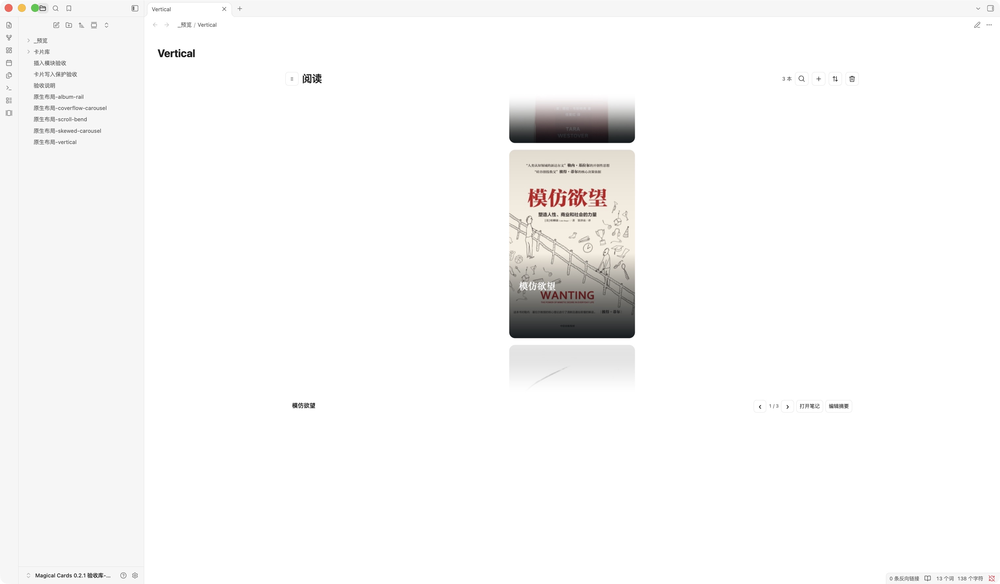
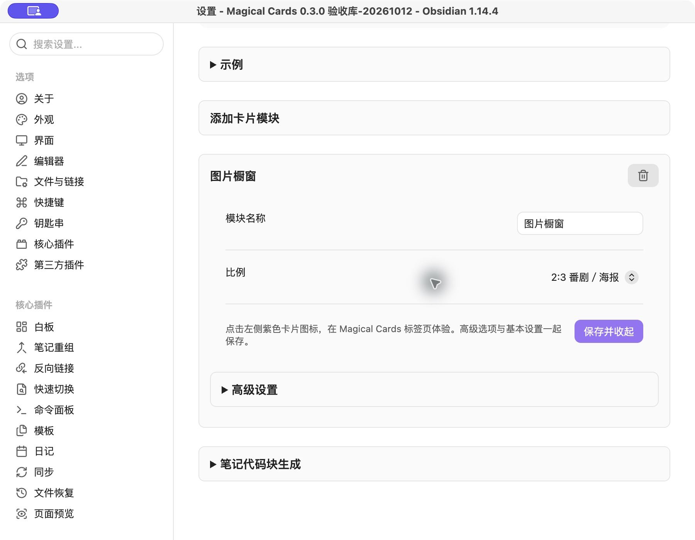
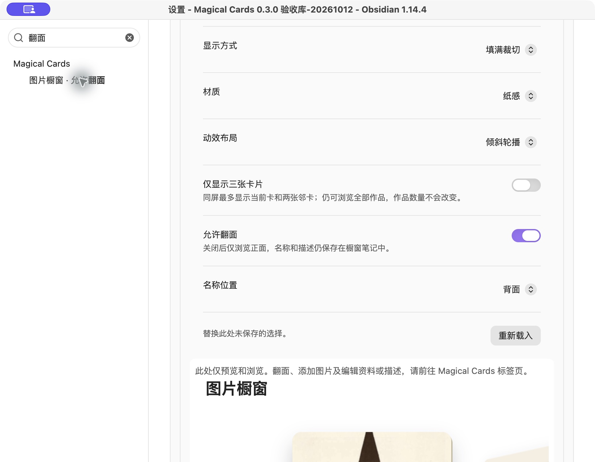
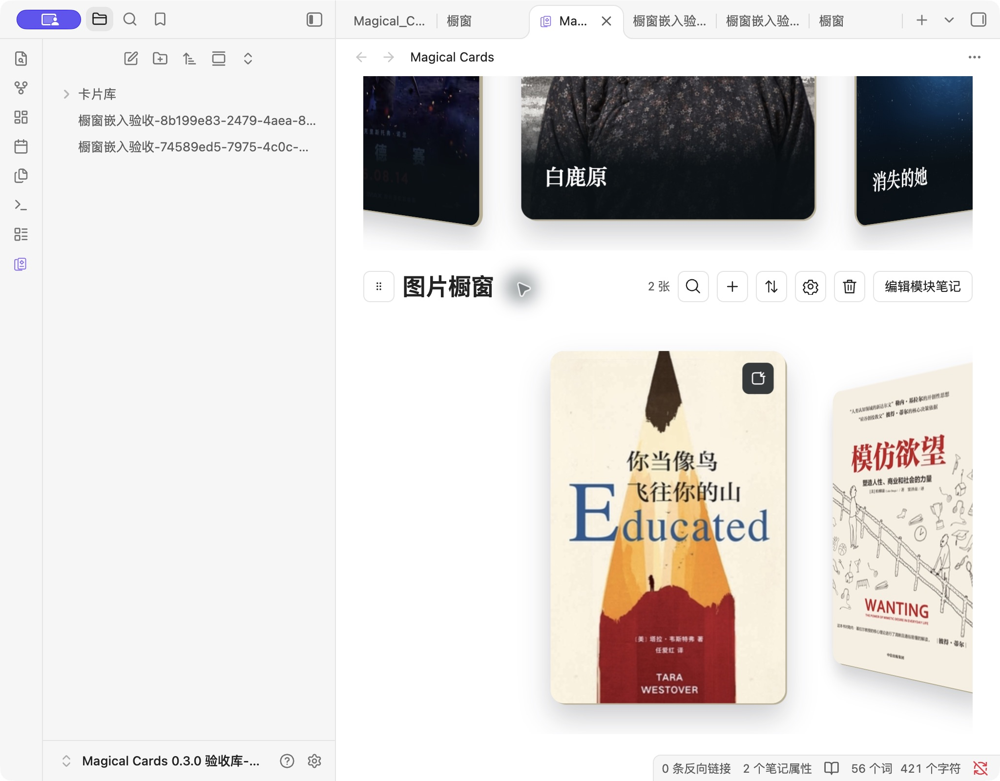
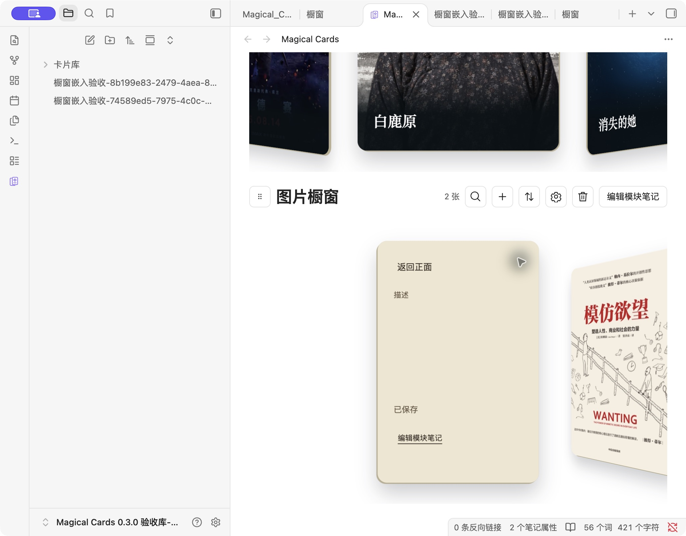
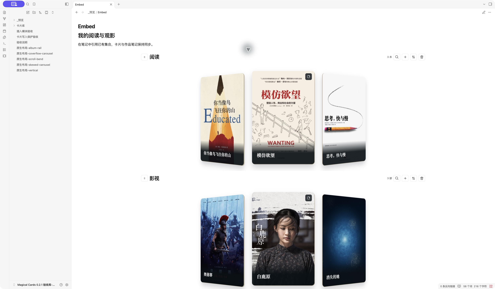

简体中文 · [English](README_en.md)

Magical Cards is a desktop Obsidian plugin for book, film, and image showcase cards, with draggable modules and note embeds. It works offline with six editable starter examples. The interface is currently in Chinese; see the [full English guide](README_en.md).

<h1 align="center">Magical Cards</h1>
<p align="center">把阅读、观影与图片收藏，变成可以浏览、编辑、嵌入笔记的卡片。</p>
<p align="center">
  <a href="https://github.com/AbigBlackCat/Obsidian-Magical_Cards/releases"></a>
  <a href="LICENSE"></a>
</p>
<p align="center">
  <a href="https://github.com/AbigBlackCat/Obsidian-Magical_Cards/releases/latest">下载插件</a> ·
  <a href="#开始使用">使用说明</a> ·
  <a href="https://github.com/AbigBlackCat/Obsidian-Magical_Cards/releases">更新日志</a> ·
  <a href="https://github.com/AbigBlackCat/Obsidian-Magical_Cards/issues">反馈问题</a>
</p>

**作者惯用卡片风格（该插件提供多种样式供选择）：**


**已上传Obsidian社区，我会不定时维护和更新，欢迎体验插件，希望你喜欢～**
https://community.obsidian.md/plugins/magical-cards


**插件的开发思路** 

我开发了一个自己用的工作台，最近改造到obsidian里后发现，这个卡片轮播的视觉效果出奇的好，大大提高了我的记录动力，不得不说颜值是第一生产力。
以前经常想要写读书笔记、观影笔记，最后总因为笔记长期维护难度大，反馈小而拖延放弃，而这个卡片轮播像集卡收藏一样，
书籍影视就这么美丽地展现到我面前，我一回忆起曾经阅读或者观看的画面就忍不住点击进入笔记写上一两句作为记录。

进一步思考，我想到这个卡片轮播也可以单纯的只展示不记录，于是新增了橱窗功能，大家喜欢的照片、角色、明星等可以通过用橱窗功能，呈现在Magical Cards窗口以及你的任意笔记里。

这个插件是从我的Obsidian工作台里独立出来的，等我的工作台开发完善了我会带它和大家见面。关于这个插件，如果你有任何建议和反馈，欢迎给我提issue,或者作为contributor参与进一步开发我的插件，你也可以fork我的插件去自定义你的功能。

传送门:https://github.com/AbigBlackCat/Obsidian-Magical_Cards/ 

## Installation

Requires **Obsidian desktop 1.11.4 or later**. In Settings → Community plugins → Browse, search for **Magical Cards**, install and enable it. [Community listing](https://community.obsidian.md/plugins/magical-cards).

For manual installation:

1. Download `main.js`, `manifest.json`, and `styles.css` from the [latest release](https://github.com/AbigBlackCat/Obsidian-Magical_Cards/releases/latest).
2. Put all three files in `<vault>/.obsidian/plugins/magical-cards/`.
3. Reload Obsidian and enable **Magical Cards** in Settings → Community plugins.

## Usage

On first use in an empty card directory, the plugin creates six offline examples and opens a guide. Open the cards view from the ribbon icon or the **打开卡片视图** command. To embed collections in a note, run **插入卡片模块** and select existing modules; the command inserts the code block into the active note. Settings also provides a generator for copying and pasting the code. See [README_en.md](README_en.md) for the complete guide.

## 目录

- [开始使用](#开始使用)
- [功能](#功能)
- [外观与设置](#外观与设置)
- [嵌入笔记](#嵌入笔记)
- [常见问题与数据](#常见问题与数据)
- [开发与版权](#开发与版权)

## 开始使用

首次在空目录启用，插件会在 `卡片库` 中创建说明页、3 本书与 3 部影视，并自动打开说明页。六张封面随插件打包，断网也能查看；示例作品可以编辑或删除。

起步外观为 **圆柱弧面、整幅封面、填满裁切、纸感、2:3、同屏最多三张卡片**。滑动或使用方向键，仍可浏览全部六张作品。

1. **打开卡片**：点击侧栏卡片图标，或执行「Magical Cards: 打开卡片视图」。
2. **添加作品**：点击模块右上角的 `+`，填写标题、封面及作品信息。
3. **记录感想**：翻到卡片背面编辑摘要，或打开关联的作品笔记。

再次查看说明，执行「查看示例及用法说明」。初始化中途失败也可通过此命令重试。已有卡片库不会重复导入示例，也不会修改原外观；删除示例后重启不会补回。

## 功能

| 功能 | 操作 |
| --- | --- |
| 浏览与搜索 | 滑动、滚轮或方向键切换卡片；点击放大镜搜索作品。 |
| 管理作品 | 添加、编辑封面和信息、关联笔记、删除作品、调整排序。 |
| 翻面摘要 | 翻到背面记录感想；布局切换保留当前卡和摘要草稿。 |
| 图片橱窗 | 每个模块共用一篇笔记，批量导入图片、可选名称及翻面描述。 |
| 模块排序 | 拖动标题前的手柄；键盘聚焦手柄后按 Alt / Option + ↑ / ↓。 |
| 笔记嵌入 | 阅读模式和实时预览均可展示集合，同一集合可以重复引用。 |

### 五种动效布局

| 封面流轮播 | 黑胶专辑架 |
| --- | --- |
|  |  |
| 横向滚动弯曲画廊 | 倾斜轮播 |
|  |  |

圆柱弧面见首页预览。滚动弯曲画廊还支持竖向：



## 外观与设置


设置依次为：**卡片目录 → 示例 → 添加卡片模块 → 已有模块 → 已移除模块 → 笔记代码块生成**。示例、已有模块、已移除模块和高级设置默认收起。

新建模块时只需填写**模块名称**、选择**比例**，然后点击**保存**。保存后点击左侧紫色叠卡图标，在 **Magical Cards** 标签页体验。设置中的预览仅能浏览和滑动，不会翻面或打开描述编辑。



“高级设置”依次包含：**卡片样式 → 显示方式 → 卡片材质 → 动效布局 → 仅显示三张卡片**。弯曲画廊才显示方向。新模块预设为 **整幅封面、填满裁切、纸感、2:3、倾斜轮播、关闭仅三张**；阅读／影视示例和已有模块保留原外观。三卡选项分别作用于各模块，仍可浏览全部图片。



模块展开后，标题右侧的垃圾桶**只移除展示**，保留配置、顺序、笔记和图片。展开“已移除模块”可恢复。保存失败或来源冲突时保留草稿，检查后重试或重新载入。

**卡片目录**填写当前笔记库内的相对目录，例如 `卡片库`。作品保存在其下的 `书籍`／`观影` 目录，橱窗在 `橱窗/<模块 ID>/`，配置保存在 `_数据/卡片配置.md`。切换目录不会搬运原有作品；不要填写电脑上的绝对路径。

### 图片橱窗

橱窗适合只展示图片的收藏。在**新建模块 → 高级设置 → 卡片样式**中选择“橱窗式卡片”，保存后存储方式固定；已有作品模块不转换为橱窗。

| 图片正面 | 翻面描述 |
| --- | --- |
|  |  |

- 点击橱窗的添加图片按钮批量选择图片，也可拖入图片。不会自动扫描文件夹；支持 PNG、JPEG、WebP、GIF、SVG，每张最大 10 MB。
- 每个橱窗独用一个文件夹与一篇 `橱窗.md`，导入图片复制到该文件夹。打开笔记即可看到全部图片、可选名称与描述。图片名称可以留空。
- 高级设置可关闭翻面，或把名称放在正面、背面、不显示。默认开启翻面、名称放在背面，正面聚焦图片。正面名称模式的背面仅显示描述；不显示名称会保留已填写文字。
- 背面描述为最多 400 字纯文本，自动保存；输入法输入期间等待确认，冲突或失败保留草稿并提供重试。关闭翻面后仍可通过“编辑当前图片”或共享笔记修改资料。
- 删除单张卡片仅移除其笔记区块，图片文件保留。图片顺序也保存在共享笔记中；修改目标字段和排序保留其他区块及未知属性。请保留卡片 ID 和管理标记。笔记缺失或标记损坏时提示修复，不会重建空笔记。
- 导入部分失败时，已保存的图片和稳定 ID 保留；在当前笔记库保持打开期间点击重试，不会重复加入成功的图片。请在关闭笔记库或停用最后一个共享卡片插件前重试；完整重启后重新选图属于新导入，可能产生重复卡片，原图片文件仍保留。

## 嵌入笔记



展开设置中的「笔记代码块生成」，选择一个或多个已有模块，然后生成并复制代码，粘贴进笔记即可。也可在笔记内执行「插入卡片模块」命令，选择模块后直接插入代码块。每次生成新的代码块 ID 和模块实例 ID；引用原作品，默认继承集合设置。

````markdown
```magical-cards
id: reading-and-films
modules:
  - id: reading-instance
    collection: book
  - id: films-instance
    collection: film
```
````

同一集合可以出现在多篇笔记中。嵌入中的模块顺序只影响该代码块；排序原子更新 `modules` 数组，保留其余正文。重复 ID、源码冲突或未保存的原生编辑会阻止覆盖并保留草稿。复制代码到同一笔记时，请重新生成 ID。

<details>
<summary>高级：在一个嵌入中覆盖布局</summary>

`collection` 引用 `book`、`film` 或已有自定义集合的稳定 ID。模块可增加 `layout`：`cylinder`、`coverflow-carousel`、`album-rail`、`scroll-bend` 或 `skewed-carousel`；弯曲画廊可增加 `orientation: vertical`。这些覆盖只影响该处展示。省略时继承集合设置。

</details>

## 常见问题与数据

**开启三卡后，其他作品会消失吗？**

不会。同屏最多显示当前卡和两张邻卡；仍可浏览全部作品，作品数量不会改变。

**封面为什么留边？**

「完整显示」保留图片全部内容，比例不同时可能留边；「填满裁切」贴满卡片，会裁切部分图片。原图自身的白边属于图片内容，插件会保留它。

**数据保存在哪里？**

作品是卡片目录中的普通 Markdown 笔记；外观与模块顺序保存在 `_数据/卡片配置.md`。插件本地配置保存目录、首次体验状态及必要恢复信息。切换目录不会重新导入示例或迁移原作品。

**是否联网或读取剪贴板？**

插件不连接账户，不执行联网同步。内置示例离线可用；自行填写远程封面 URL 时会向相应图片服务器加载资源。「复制」只在用户点击后写入生成的代码；关联笔记选择器搜索笔记库中的笔记路径，不向外发送笔记内容。

**可以在手机上使用吗？**

目前仅支持桌面版。原生验收使用 macOS；Windows 尚未实机验证。插件界面目前为中文。

<details>
<summary>由旧 Barry Cards 升级与草稿恢复</summary>

原 `barry-cards` 代码块、作品 ID、`bw_*` 属性、视图和恢复草稿继续兼容；旧目录及未知配置字段保留。

先备份原 `.obsidian/plugins/barry-cards/` 与卡片目录，再停用旧插件，等待未保存修改写入完成。将三个新文件安装到 `magical-cards`，把原 `data.json` 和恢复 JSON 一并保留到新目录，最后按原启用状态启用新插件。不要同时启用两个独立插件。

兼容宿主可以共享同一运行时。新版仅补充缺少的代码块语言与封面读取能力，保留现有作品、编辑和排序草稿。最终停用时保存失败的草稿会写入插件目录的恢复 JSON，并提示位置。

</details>

**0.3.0 更新**：新增橱窗式卡片，支持批量图片、可选名称与翻面描述；模块设置简化为名称和比例，高级项默认收起，三卡分别按模块设置；阅读、影视和自定义模块可移除展示并恢复，保留原数据和顺序。设置预览仅供浏览，编辑请使用左侧紫色卡片图标打开 Magical Cards 标签页。

## 开发与版权

[示例笔记库](examples/vault/) 仅包含三本书、三部影视及独立示例 ID；安装三个插件文件后用 Obsidian 打开即可。其卡片目录为「示例」。[说明页模板](examples/Magical_Cards示例及用法说明.md) 用于首次体验。

```sh
npm ci
npm run lint
npm run typecheck
npm test
npm run build
```

浏览器开发预览：`npm run preview`，打开 `http://127.0.0.1:4319`。原生验收与平台限制见 [VERIFICATION.md](VERIFICATION.md)，社区审核进度见 [COMMUNITY.md](COMMUNITY.md)。

代码采用 [MIT](LICENSE)。第三方封面及含封面的预览图不受代码许可证授权，其权利归各自权利人；请保留[封面来源与版权](examples/SOURCES.md)。布局、React 及构建适配说明见 [THIRD_PARTY.md](THIRD_PARTY.md)。
