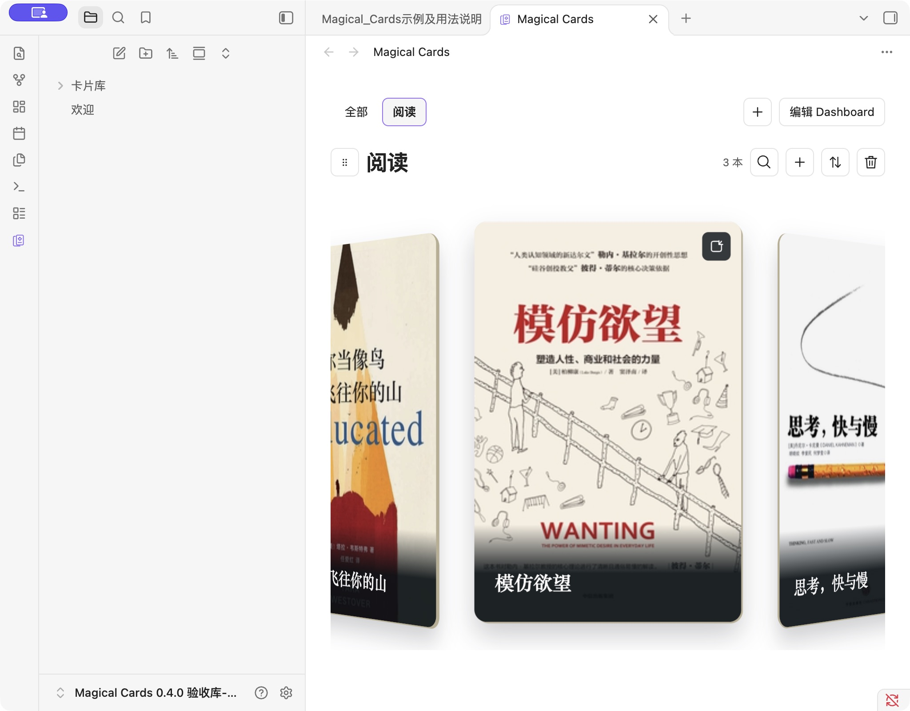

[简体中文](README.md) · English

<h1 align="center">Magical Cards</h1>
<p align="center">Browse your books and films as cover cards, and bring them into your notes.</p>
<p align="center">
  <a href="https://github.com/AbigBlackCat/Obsidian-Magical_Cards/releases"></a>
  <a href="LICENSE"></a>
</p>
<p align="center">
  <a href="https://github.com/AbigBlackCat/Obsidian-Magical_Cards/releases/latest">Download</a> ·
  <a href="#usage">Usage</a> ·
  <a href="https://github.com/AbigBlackCat/Obsidian-Magical_Cards/releases">Changelog</a> ·
  <a href="https://github.com/AbigBlackCat/Obsidian-Magical_Cards/issues">Report a bug</a>
</p>

**The author’s preferred card style; the plugin offers several layouts:**


[Available in the Obsidian community](https://community.obsidian.md/plugins/magical-cards), with ongoing updates.


Magical Cards is a desktop Obsidian plugin for browsing and editing book, film and image showcase cards. Open a dedicated cards view or embed collections in your notes. Both use the same work notes, with search, sorting, linked notes, and editable summaries on the back of each card.

**The interface is currently in Chinese.** This guide includes the original labels so you can find the controls. Install from the community browser or use the manual steps below.

## Contents

- [Installation](#installation)
- [Usage](#usage)
- [Features and layouts](#features-and-layouts)
- [Settings](#settings)
- [Note embeds](#note-embeds)
- [FAQ and data](#faq-and-data)
- [Development and license](#development-and-license)

## Installation

Requires **Obsidian desktop 1.11.4 or later**. In Settings → Community plugins → Browse, search for **Magical Cards**, install and enable it.

For manual installation:

1. Download `main.js`, `manifest.json`, and `styles.css` from the [latest release](https://github.com/AbigBlackCat/Obsidian-Magical_Cards/releases/latest).
2. Put all three files in `<vault>/.obsidian/plugins/magical-cards/`.
3. Reload Obsidian and enable **Magical Cards** in Settings → Community plugins.

Mobile is not supported. Native verification is performed on macOS; Windows has not been tested on physical hardware.

## Usage

On first use in an empty directory, the plugin creates a guide, three books, and three films in `卡片库` and opens the guide. The six editable covers are bundled with the plugin and work offline.

The initial appearance is **cylindrical layout, full cover, fill and crop, paper material, 2:3, and at most three visible cards**. You can still browse every work by swiping or using the arrow keys.

1. **Open cards:** use the ribbon cards icon or the **打开卡片视图** (Open cards view) command.
2. **Add a work:** click `+` in a module and enter its title, cover, and details.
3. **Write a summary:** flip a card to edit its back, or open the linked work note.

The **查看示例及用法说明** (Open examples and guide) command reopens the guide and can retry an interrupted initialization. Existing collections and appearances are preserved. Deleted examples do not return on restart.

## Features and layouts

| Feature | How to use it |
| --- | --- |
| Browse and search | Swipe, scroll, or use arrow keys. Click the magnifying glass to search. |
| Manage works | Add or edit covers and details, link notes, delete works, and change their order. |
| Back-of-card summaries | Flip the card and write. Switching layouts preserves the current card and summary draft. |
| Dashboards | Switch between 全部 (All) and custom categories, manually select existing modules, and keep a separate order for each category. |
| Reorder modules | Drag the title handle, or focus it and press Alt / Option + ↑ / ↓. |
| Embed collections | Use reading mode or Live Preview; the same collection can appear in multiple notes. |

### Dashboards

The **全部** (All) tab at the top of Magical Cards shows every module that is not hidden. Click `+` to create a Dashboard, enter its name, select existing modules, and click **保存 Dashboard** (Save Dashboard). Every checkbox starts unchecked, and new modules are never assigned automatically. A module appears in multiple Dashboards only when you manually select it; its notes and images remain shared.

In a category, use **编辑 Dashboard** (Edit Dashboard) to change its name or membership. Deleting a Dashboard removes only the category, preserving its modules, notes and images. Each Dashboard saves its own module order, independently of All. Categories reference stable existing module IDs and do not change work notes or the collection references and local ordering of note embeds.

The module heading provides a management action for the current page:

- **Hide a module in All:** hide it from All and every Dashboard in the Magical Cards tab. Note embeds continue to display it. Expand **已隐藏模块** (Hidden modules), collapsed by default on All, to restore its category membership, appearance and order.
- **Remove a module from a Dashboard:** remove only its reference in the current category. All and other Dashboards are unchanged. To add it back, use **编辑 Dashboard** (Edit Dashboard), select the original module, and save.
- **Delete a module:** after confirmation, remove its configuration and every Dashboard reference. Work notes, showcase notes, images and work IDs remain intact. Existing note embeds report that the module was deleted; there is no module restoration control.
- **Trash in the card toolbar:** delete the current individual card, rather than the entire module. Read the confirmation before deleting.

Hiding is reversible and preserves module configuration; removing a category reference affects that category only. Deleting a module removes its configuration and category references while preserving notes and images. If a compatible host is also enabled, upgrade it to **0.1.37**; an older shared runtime prompts an upgrade instead of attempting deletion. If the shared runtime does not support Dashboards, upgrade the enabled compatible cards plugins and restart the vault; existing modules and data remain intact.

### Five layouts

| Coverflow carousel | Album rail |
| --- | --- |
|  |  |
| Horizontal curved gallery | Skewed carousel |
|  |  |

The cylindrical layout is shown at the top of this page. The curved gallery also supports vertical scrolling:


Layouts do not autoplay. Album rail displays sleeves without playback controls or a spinning record. The curved gallery provides an **打开笔记** (Open note) control for the current card and a summary editor. It falls back to ordinary cards if WebGL or texture loading fails. The system's reduced-motion preference disables bending and transitions.



## Appearance and settings

Settings are ordered as **Card directory → Examples → Add cards module → Add image showcase → Existing modules → Hidden modules (legacy) → Note code generator**. Both creation groups, examples, existing modules, legacy hidden modules and advanced settings start collapsed.

Expand **添加卡片模块** (Add cards module) or **添加图片橱窗** (Add image showcase), enter a **module name**, choose its **aspect ratio**, then click **保存并收起** (Save and collapse). Each creator keeps its own draft and a fixed storage type; advanced card style offers full cover or minimal without converting the module type. Click the purple stacked-card ribbon icon to experience the module in the **Magical Cards** tab. Settings previews support browsing and sliding only; they cannot flip or start editing sessions.


**高级设置** (Advanced settings) contains **card style → image fit → material → layout → three-card limit**. Direction appears only for the curved gallery. New modules default to **full cover, fill and crop, paper, 2:3, skewed carousel, three-card limit off**. Reading/film examples and existing modules keep their appearance. The three-card option is per module and does not remove any images.


The trash icon beside an expanded module's heading **deletes the module** after confirmation: its configuration, category references and module positions are removed, while work notes, showcase notes and images remain intact. Existing note embeds report a deleted module and stop displaying its cards. There is no module restoration control. To temporarily remove a module from the cards view, use **隐藏模块** (Hide module) and restore it from All → **已隐藏模块** (Hidden modules). Modules hidden by older versions remain restorable through Settings → **已隐藏模块（旧版）** (Hidden modules, legacy). Failed saves and source conflicts preserve your draft and the original module for retry or explicit reload.

Enter a directory relative to the current vault, such as `卡片库`. Work notes live under `书籍` (books) and `观影` (films); showcases live under `橱窗/<module ID>/`. Configuration is in `_数据/卡片配置.md`. Changing this setting does not move existing data. Absolute computer paths are rejected.

### Image showcases

Expand the separate **添加图片橱窗** (Add image showcase) settings group, enter a name, choose the aspect ratio, and save. This creator always creates a showcase; existing work modules cannot be converted. Failed saves keep the draft and any already-created showcase note, so retry does not create another note.

| Image front | Description on the back |
| --- | --- |
|  |  |

- Select multiple images or drag images into the showcase. Folders are never scanned automatically. PNG, JPEG, WebP, GIF and SVG are supported, up to 10 MB per image.
- Each showcase has its own folder containing one `橱窗.md` note and all imported images. The note uses local embeds to show every image, optional name and description. Names may be empty.
- Advanced options enable flipping and place names on the front, back, or nowhere. Flipping is on and names are on the back by default. Front-name mode shows only the description on the back; hiding names preserves the stored text.
- Descriptions are plain text, limited to 400 characters, and saved automatically. IME composition waits for confirmation; failed saves and conflicts retain the draft with retry controls. With flipping off, use **编辑当前图片** (Edit current image) or edit the shared note.
- Removing a card removes only its note block and keeps the image file. Ordering and field edits preserve other blocks, unknown properties and surrounding text. Keep card IDs and management markers intact. Missing notes or damaged markers require repair; an empty replacement note is never generated.
- Partial imports preserve saved files and stable IDs. Retry while the same library remains open does not duplicate successful cards. Retry before closing the vault or disabling the last shared cards plugin; after a full restart, selecting images again is a new import and may duplicate cards. Saved image files remain intact.

## Note embeds


Expand **笔记代码块生成** (Generate a note code block) in Settings. Select one or more existing modules, generate and copy the code, then paste it into a note. Alternatively, run **插入卡片模块** (Insert cards modules) in a note; selecting modules inserts the code block directly into that note.

Each generation creates new block and module-instance IDs. The block references existing works and inherits collection appearance; it does not duplicate work data.

````markdown
```magical-cards
id: reading-and-films
modules:
  - id: reading-instance
    collection: book
  - id: films-instance
    collection: film
```
````

Dragging modules inside an embed changes only that block. The plugin atomically updates its `modules` array and preserves the rest of the note. Duplicate IDs, source conflicts, or unsaved native editor changes block an overwrite and preserve the draft. Generate fresh IDs when duplicating a block within the same note.

<details>
<summary>Advanced: override a layout for one embed</summary>

`collection` refers to `book`, `film`, or an existing custom collection's stable ID. Add `layout` to a module to select `cylinder`, `coverflow-carousel`, `album-rail`, `scroll-bend`, or `skewed-carousel`. A curved gallery can also use `orientation: vertical`. Overrides apply only to that embed; omitted values inherit collection settings.

</details>

## FAQ and data

**Does the three-card option hide or delete other works?**

No. It shows the current card and at most two neighbors at once. Every work remains available to browse; collection size is unchanged.

**Why is there space around a cover?**

Show whole image preserves all image content and may leave space when the ratios differ. Fill and crop fills the card and crops part of the image. A border already present in the original image remains part of that image.

**Where is my data saved?**

Works are ordinary Markdown notes inside the card directory. Appearance and module order are stored in `_数据/卡片配置.md`. Local plugin configuration stores the directory, first-run progress, and recovery information. Switching directories neither imports examples again nor moves existing works.

**What if the tab turns black after changing an appearance?**

Wait for the save to finish, quit and restart Obsidian, then reopen the same vault. The appearance is saved and works and images are preserved. Saving appearance changes to an existing module also shows this recovery hint.

**Does the plugin use the network or clipboard?**

No account or data sync is required. Built-in examples work offline. User-supplied remote cover URLs load from their image servers. The Copy control writes generated code only after you click it. When editing a title, pasting reads only the plain text from that paste event; there is no background clipboard reading. The linked-note picker searches note paths within your vault and does not send note content elsewhere.

<details>
<summary>Upgrading from Barry Cards and recovering drafts</summary>

Existing `barry-cards` blocks, work IDs, `bw_*` properties, views, and recovery drafts remain compatible. Previous directory settings and unknown configuration fields are preserved.

Back up `.obsidian/plugins/barry-cards/` and your card directory, then disable the old plugin and let pending edits finish saving. Install the three new files in `magical-cards`, preserve the old `data.json` and recovery JSON files in the new directory, then enable the new plugin according to the previous enabled state. Do not enable both standalone plugins together.

Compatible hosts share the existing runtime. New versions add missing block languages and cover-reading support without recreating collections or clearing editing and sorting drafts. If a draft cannot be saved during final shutdown, it is written to a recovery JSON file in the plugin directory and its location is shown.

</details>

**0.3.0 changes:** image showcases add batch import, optional names and editable back descriptions. Basic module settings are now name and aspect ratio, with advanced options collapsed and a three-card limit per module. Reading, film and custom modules can be hidden and restored without losing data or order. Settings previews only browse; use the purple cards ribbon icon to open the Magical Cards tab for editing.

**0.3.1 changes:** curved galleries retire unused WebGL contexts and reuse their canvas for ratio and direction changes; the first-run guide uses the author's revised text; the new showcase option is named “添加图片橱窗” (Add image showcase); appearance saves include a recovery hint for a black tab.

**0.4.0 changes:** cards modules and image showcases have separate collapsed creators with independent drafts. The cards view adds All and named Dashboards with manual existing-module selection, editing, deletion and independent module ordering. Categories share existing data, new modules are not assigned automatically, and module hiding remains global.

**0.4.2 changes:** hiding remains reversible, and **移出此 Dashboard** (Remove from this Dashboard) changes only the current category. Confirmed **移除模块** (Delete module) removes module configuration, all category references and module positions while preserving work notes and images. Existing embeds report a deleted module; there is no module restoration control. Unsaved edits and ordering are checked before deletion; failures and conflicts preserve the original module and drafts. Compatible host: **0.1.37**.

## Development and license

The [example vault](examples/vault/) contains only three books, three films, and independent example IDs. Install the three plugin files and open it with Obsidian. Its card directory is `示例`. The [guide template](examples/Magical_Cards示例及用法说明.md) is used for the first-run experience.

```sh
npm ci
npm run lint
npm run typecheck
npm test
npm run build
```

For the browser development preview, run `npm run preview` and open `http://127.0.0.1:4319`. See [VERIFICATION.md](VERIFICATION.md) for recorded checks and platform limits, and [COMMUNITY.md](COMMUNITY.md) for community review status.

Code is licensed under [MIT](LICENSE). Third-party covers and previews containing them are excluded from the code license and remain the property of their rights holders. Preserve the [cover sources and rights notice](examples/SOURCES.md). Layout, React, and build adaptation notices are in [THIRD_PARTY.md](THIRD_PARTY.md).
