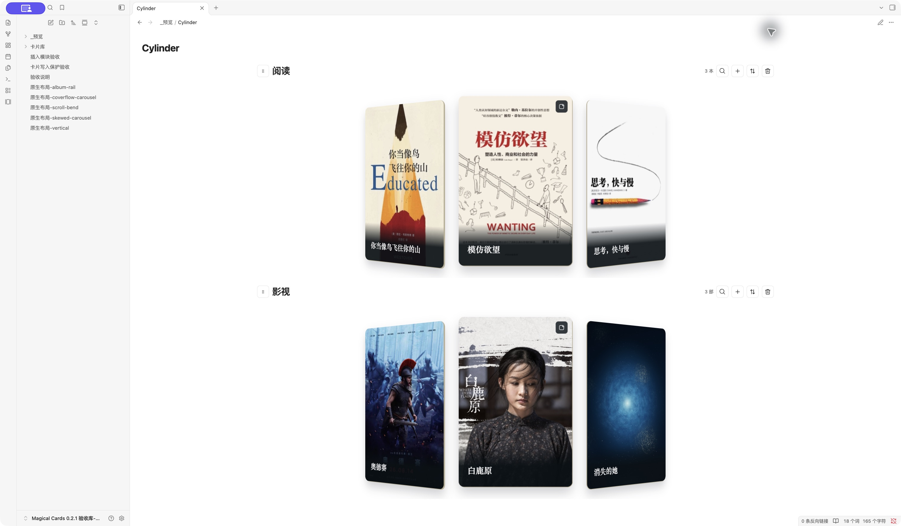

[简体中文](README.md) · English

<h1 align="center">Magical Cards</h1>
<p align="center">Browse your books and films as cover cards, and bring them into your notes.</p>
<p align="center">
  <a href="https://github.com/AbigBlackCat/Obsidian-Magical_Cards/releases"></a>
  <a href="LICENSE"></a>
</p>
<p align="center">
  <a href="https://github.com/AbigBlackCat/Obsidian-Magical_Cards/releases/latest">Download</a> ·
  <a href="#usage">Usage</a> ·
  <a href="https://github.com/AbigBlackCat/Obsidian-Magical_Cards/releases">Changelog</a> ·
  <a href="https://github.com/AbigBlackCat/Obsidian-Magical_Cards/issues">Report a bug</a>
</p>



Magical Cards is a desktop Obsidian plugin for browsing and editing book and film cover cards. Open a dedicated cards view or embed collections in your notes. Both use the same work notes, with search, sorting, linked notes, and editable summaries on the back of each card.

**The interface is currently in Chinese.** This guide includes the original labels so you can find the controls. The community entry is a draft under review; manual installation is available.

## Contents

- [Installation](#installation)
- [Usage](#usage)
- [Features and layouts](#features-and-layouts)
- [Settings](#settings)
- [Note embeds](#note-embeds)
- [FAQ and data](#faq-and-data)
- [Development and license](#development-and-license)

## Installation

Requires **Obsidian desktop 1.11.4 or later**.

1. Download `main.js`, `manifest.json`, and `styles.css` from the [latest release](https://github.com/AbigBlackCat/Obsidian-Magical_Cards/releases/latest).
2. Put all three files in `<vault>/.obsidian/plugins/magical-cards/`.
3. Reload Obsidian and enable **Magical Cards** in Settings → Community plugins.

Mobile is not supported. Native verification is performed on macOS; Windows has not been tested on physical hardware.

## Usage

On first use in an empty directory, the plugin creates a guide, three books, and three films in `卡片库` and opens the guide. The six editable covers are bundled with the plugin and work offline.

The initial appearance is **cylindrical layout, full cover, fill and crop, paper material, 2:3, and at most three visible cards**. You can still browse every work by swiping or using the arrow keys.

1. **Open cards:** use the ribbon cards icon or the **打开卡片视图** (Open cards view) command.
2. **Add a work:** click `+` in a module and enter its title, cover, and details.
3. **Write a summary:** flip a card to edit its back, or open the linked work note.

The **查看示例及用法说明** (Open examples and guide) command reopens the guide and can retry an interrupted initialization. Existing collections and appearances are preserved. Deleted examples do not return on restart.

## Features and layouts

| Feature | How to use it |
| --- | --- |
| Browse and search | Swipe, scroll, or use arrow keys. Click the magnifying glass to search. |
| Manage works | Add or edit covers and details, link notes, delete works, and change their order. |
| Back-of-card summaries | Flip the card and write. Switching layouts preserves the current card and summary draft. |
| Reorder modules | Drag the title handle, or focus it and press Alt / Option + ↑ / ↓. |
| Embed collections | Use reading mode or Live Preview; the same collection can appear in multiple notes. |

### Five layouts

| Coverflow carousel | Album rail |
| --- | --- |
|  |  |
| Horizontal curved gallery | Skewed carousel |
|  |  |

The cylindrical layout is shown at the top of this page. The curved gallery also supports vertical scrolling:


Layouts do not autoplay. Album rail displays sleeves without playback controls or a spinning record. The curved gallery provides an **打开笔记** (Open note) control for the current card and a summary editor. It falls back to ordinary cards if WebGL or texture loading fails. The system's reduced-motion preference disables bending and transitions.

## Settings


Settings appear in this order: **卡片目录** (Card directory), **示例** (Examples), **仅显示三张卡片** (Show only three cards), **添加卡片模块** (Add a module), existing modules, and **笔记代码块生成** (Generate a note code block).

Examples and module controls start collapsed. Expand them, make your choices, then click **保存并收起** (Save and collapse) to apply all choices together. A failed save keeps the form open and retains the draft.

| Order | Control | Default for new users and modules |
| --- | --- | --- |
| 1 | 卡片样式 — Card style: full cover / minimal | Full cover |
| 2 | 显示方式 — Image fit: show whole image / fill and crop | Fill and crop |
| 3 | 卡片材质 — Material: paper / frosted / holographic | Paper |
| 4 | 比例 — Aspect ratio: five available ratios | 2:3 |
| 5 | 动效布局 — Layout: five available layouts | Cylindrical |

Horizontal/vertical direction appears only for the curved gallery. A new module starts with these defaults; editing one module does not reset another module's appearance.

**Card directory:** enter a path relative to the current vault, such as `卡片库`. Work notes are stored in its `书籍` (books) and `观影` (films) subdirectories. Configuration is stored in `_数据/卡片配置.md`. Changing the directory does not move existing works. Do not enter an absolute path on your computer.

## Note embeds


Expand **笔记代码块生成** (Generate a note code block) in Settings. Select one or more existing modules, generate and copy the code, then paste it into a note. Alternatively, run **插入卡片模块** (Insert cards modules) in a note; selecting modules inserts the code block directly into that note.

Each generation creates new block and module-instance IDs. The block references existing works and inherits collection appearance; it does not duplicate work data.

````markdown
```magical-cards
id: reading-and-films
modules:
  - id: reading-instance
    collection: book
  - id: films-instance
    collection: film
```
````

Dragging modules inside an embed changes only that block. The plugin atomically updates its `modules` array and preserves the rest of the note. Duplicate IDs, source conflicts, or unsaved native editor changes block an overwrite and preserve the draft. Generate fresh IDs when duplicating a block within the same note.

<details>
<summary>Advanced: override a layout for one embed</summary>

`collection` refers to `book`, `film`, or an existing custom collection's stable ID. Add `layout` to a module to select `cylinder`, `coverflow-carousel`, `album-rail`, `scroll-bend`, or `skewed-carousel`. A curved gallery can also use `orientation: vertical`. Overrides apply only to that embed; omitted values inherit collection settings.

</details>

## FAQ and data

**Does the three-card option hide or delete other works?**

No. It shows the current card and at most two neighbors at once. Every work remains available to browse; collection size is unchanged.

**Why is there space around a cover?**

Show whole image preserves all image content and may leave space when the ratios differ. Fill and crop fills the card and crops part of the image. A border already present in the original image remains part of that image.

**Where is my data saved?**

Works are ordinary Markdown notes inside the card directory. Appearance and module order are stored in `_数据/卡片配置.md`. Local plugin configuration stores the directory, first-run progress, and recovery information. Switching directories neither imports examples again nor moves existing works.

**Does the plugin use the network or clipboard?**

No account or data sync is required. Built-in examples work offline. User-supplied remote cover URLs load from their image servers. The Copy control writes generated code only after you click it. The linked-note picker searches note paths within your vault and does not send note content elsewhere.

<details>
<summary>Upgrading from Barry Cards and recovering drafts</summary>

Existing `barry-cards` blocks, work IDs, `bw_*` properties, views, and recovery drafts remain compatible. Previous directory settings and unknown configuration fields are preserved.

Back up `.obsidian/plugins/barry-cards/` and your card directory, then disable the old plugin and let pending edits finish saving. Install the three new files in `magical-cards`, preserve the old `data.json` and recovery JSON files in the new directory, then enable the new plugin according to the previous enabled state. Do not enable both standalone plugins together.

Compatible hosts share the existing runtime. New versions add missing block languages and cover-reading support without recreating collections or clearing editing and sorting drafts. If a draft cannot be saved during final shutdown, it is written to a recovery JSON file in the plugin directory and its location is shown.

</details>

## Development and license

The [example vault](examples/vault/) contains only three books, three films, and independent example IDs. Install the three plugin files and open it with Obsidian. Its card directory is `示例`. The [guide template](examples/Magical_Cards示例及用法说明.md) is used for the first-run experience.

```sh
npm ci
npm run lint
npm run typecheck
npm test
npm run build
```

For the browser development preview, run `npm run preview` and open `http://127.0.0.1:4319`. See [VERIFICATION.md](VERIFICATION.md) for recorded checks and platform limits, and [COMMUNITY.md](COMMUNITY.md) for community review status.

Code is licensed under [MIT](LICENSE). Third-party covers and previews containing them are excluded from the code license and remain the property of their rights holders. Preserve the [cover sources and rights notice](examples/SOURCES.md). Layout, React, and build adaptation notices are in [THIRD_PARTY.md](THIRD_PARTY.md).
