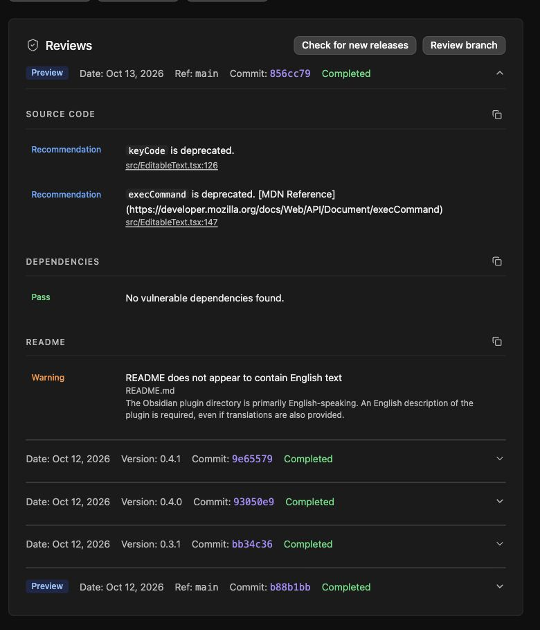

# 0.4.1 社区建议整改验证

2026-10-13，本轮只修改文档及测试，不修改 `src/`、版本、安装文件或用户数据。中文主 README 和作者开发思路保留；补充明确的英文简介与主动粘贴说明，社区说明同步到 0.4.1／兼容版 0.1.36。

## 自动测试

新增 7 项测试，总计 **192/192** 通过，类型检查、lint、示例资源一致性、可复现构建和安装文件检查通过。Lint 保留原来的 3 项警告；不关闭规则。新测试覆盖：

- compositionstart 前、composition 中、compositionend 后的 Enter／Escape；`keyCode === 229` 且 `isComposing === false` 时，不保存、取消或失焦，确认后的普通按键仍有效。
- 只读取该次粘贴的 `text/plain`，清理换行与控制字符，保留完整 Emoji；标题／副标题及整个草稿的长度限制。
- `insertText` 成功时不走后备路径；失败时只替换编辑区域内选区，外部选区不被删除或插入 HTML。

共享卡片目录同步相同文档和测试；干净宿主检出通过 **251/251** 项宿主测试、**192/192** 项卡片测试及两套类型检查。原有甘特图工作区改动保留。

## 真实粘贴、撤销与重做

使用实际 `EditableText` 的内存页面，通过 Chrome 系统粘贴验证：带格式剪贴板转为无 HTML 的单行纯文本；⌘Z 恢复原名称，⌘⇧Z 恢复粘贴文字，Enter 只保存一次。

在 Obsidian **1.14.4** 的专用 0.4.1 验收库重复格式粘贴、⌘Z、⌘⇧Z，然后 Esc 取消。18 个卡片目录文件在操作前后逐字节一致。真实用户笔记库不参与编辑测试。

可重复的内存页面：先运行 `npm ci`，再执行 `node tests/editable-text-browser.mjs`，在浏览器打开输出的本地地址。粘贴带格式文本，保持标题聚焦，依次撤销、重做、Enter；下方保存记录应只出现最终的纯文本一次。页面无笔记库 API；关闭后丢弃全部测试内容。

## 社区分支复审

2026-10-13，在社区账户页通过 Review branch 对 `main` 的提交 `856cc79ca6dff1779c3032c2aebdd421f5a41e32` 运行预审，状态为 **Completed**，没有 Failed／Error 项。依赖检查通过；源码仍有 `keyCode`、`execCommand` 两项 Recommendation，README 仍有英文识别 Warning。中文主文档按作者要求保留，扩充的英文简介和完整英文文档作为审核依据；不声称警告已消除。

分支预审只运行源码、依赖和 README 检查，没有重跑发布包的行为、网络、产物证明或可复现构建检查。已发布 0.4.1 原报告的 Vault Enumeration／Clipboard Access 建议不能据此视为消失；完整发布包报告及功能依据见 [COMMUNITY.md](../COMMUNITY.md)。自动扫描完成不代表人工审核通过。

## 产物与限制

重新构建的三个安装文件 SHA-256 与已发布 0.4.1 完全一致：

| 文件 | SHA-256 |
| --- | --- |
| main.js | 31fb174fc07eec977753c7df4da6b2f36e2c12f5c3fe04e8067042d771438718 |
| manifest.json | b3c8d13203864de5bdf778cb19e29593de2d185a443a36620a010b57fd1c8425 |
| styles.css | 24320065e15eb262b63adcfd89f15734a7ffe8bcab43a705ec9badd2ccd16ded |

输入法事件边界由自动测试覆盖，未逐一实测所有系统输入法；Windows 未实机验证。原生撤销证据来自真实系统快捷键，不由模拟 `execCommand` 的测试推断。旧版 API 的建议及英文识别警告是否变化，以对应版本／分支的实际社区审核为准。
